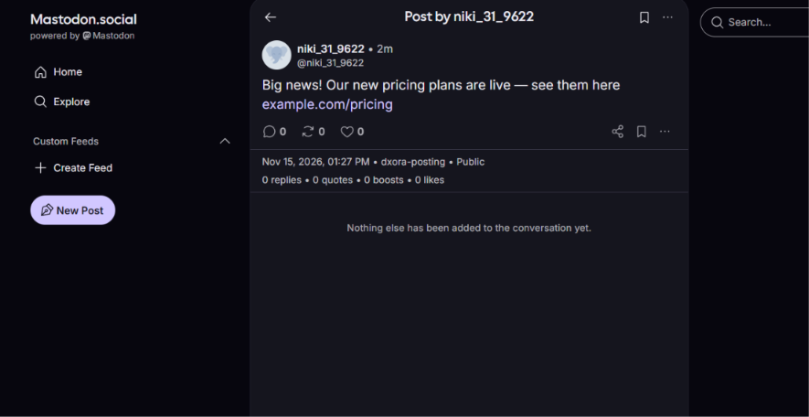
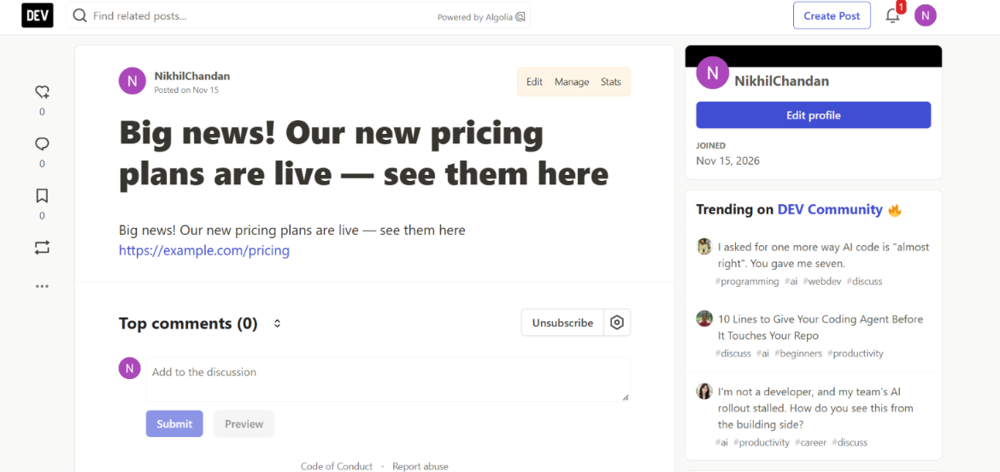
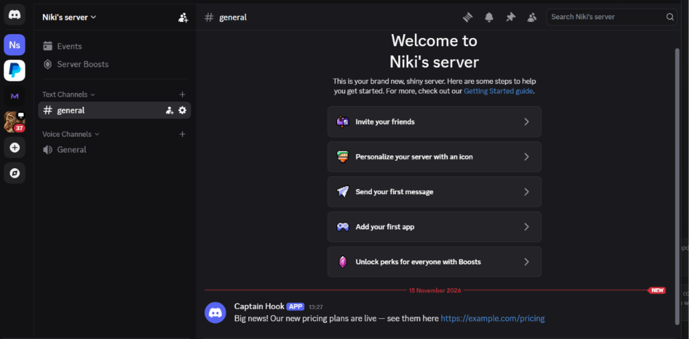

# Screenshots & logs

Proof of a real `POST /posting` run on 2026-11-15 with Mastodon, Discord and
DEV.to configured. Bluesky and Telegram were intentionally left unconfigured to
show that one platform's absence/failure does not stop the others.

The exact API response from this run is saved in
[`live-response.json`](live-response.json) (`success: true`, three platforms
`success`, two honest `not configured`).

## Mastodon — published (public)

## DEV.to — published article

## Discord — delivered to channel

Live links from this run:
- Mastodon: https://mastodon.social/@niki_31_9622/117619389646749087
- DEV.to: https://dev.to/nikhilchandan_486bc60e209/big-news-our-new-pricing-plans-are-live-see-them-here-4kga
- Discord: delivered to the server channel (webhook posts have no public permalink)
